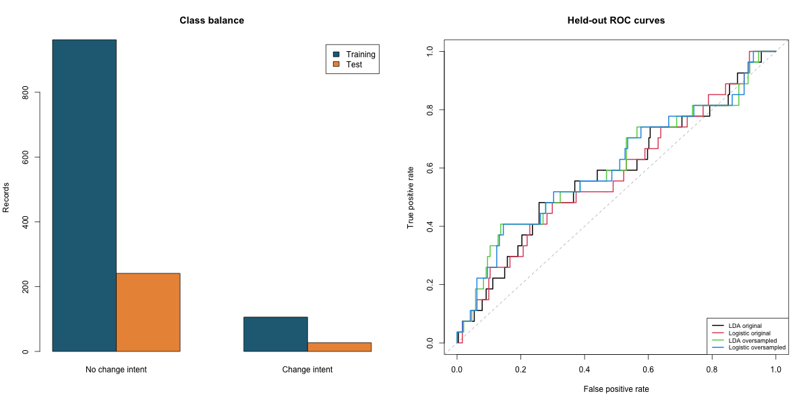

# Data Scientist Job-Change Analysis

Retrospective job-change intent analysis with training-only preprocessing and sampling.

## Run

Requires R 4.4+ and packages MASS and jsonlite.

```r
install.packages(c("MASS", "jsonlite"))
```

```sh
Rscript scripts/run.R
Rscript tests/checks.R
```

Generated metrics and figures are saved in `results/`. Read [input provenance](data/README.md) and [method changes](docs/provenance.md).

## Executed results

All models use the same held-out records. Positive class is explicitly defined in metrics.json. Confusion matrices contain actual classes as rows and predicted classes as columns, in order 0, 1. Classification threshold is 0.5 for logistic regression.

| Model | Accuracy | Positive recall | Precision | ROC AUC |
|---|---:|---:|---:|---:|
| LDA original | 0.896 | 0.000 | 0.000 | 0.581 |
| Logistic original | 0.899 | 0.000 | 0.000 | 0.575 |
| LDA oversampled | 0.634 | 0.519 | 0.141 | 0.605 |
| Logistic oversampled | 0.642 | 0.519 | 0.144 | 0.606 |

The majority-class baseline is 0.899. Original models identify no positive cases; oversampling improves recall while producing many false positives. This small city-specific holdout has only 27 positives. Results are exploratory, not evidence for hiring or personnel decisions. Gender and enrollee ID are excluded from predictors.

Original collaborators: **Abhinav Tanwar, Satya Vamsi Chittala, Pavan Anakanti**.

## Reproducibility and scope

Seeds are fixed in source. Validation uses numerical invariants or input/split checks. This is a maintained reconstruction of the supplied work; methodological corrections and newly generated data mean some results intentionally differ from the original reports. Original PDFs are omitted to avoid publishing student identifiers.

## Reports

`report.html` is a ready-to-open summary. To render the R Markdown version after running the analysis, install `rmarkdown` and `knitr`, install Pandoc, and run `rmarkdown::render("report.Rmd")` from the repository root. The optional R Markdown rendering was not executed in the local environment because Pandoc is unavailable.



Categorical experience and company-size values are one-hot encoded, rather than treating arbitrary category spacings as numeric distances. Training hours use log1p. Training-only missing-value counts are saved in results/training-missingness.csv.
